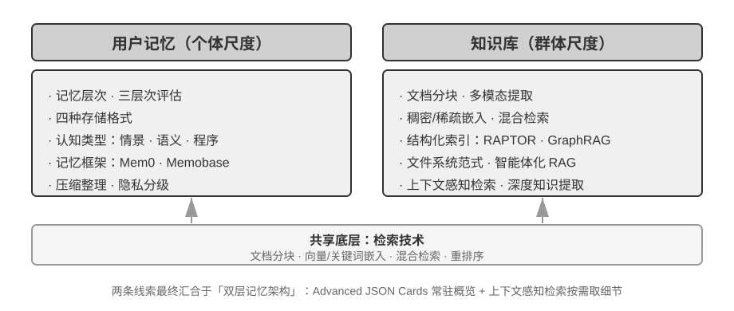
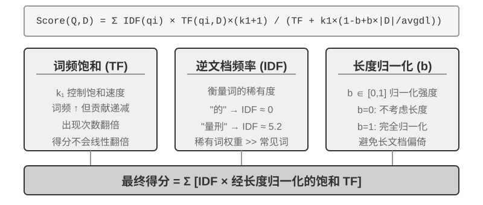
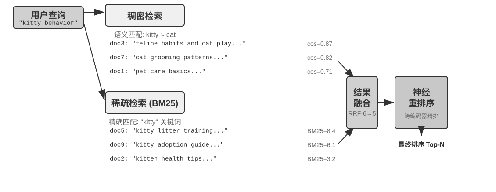

# 第 3 章 学习笔记：用户记忆和知识库

> 核心一句话：跨会话记住用户、接入外部知识：用户记忆、RAG、结构化索引、知识图谱

## 正文要点和思考

### 1. 总观点：两个尺度，一套底层技术

第二章我学的是“单次交互里的上下文怎么摆”——怎么在一次对话里把系统提示词、工具定义、历史消息塞得整整齐齐，既不爆 token 又能吃满 KV Cache。

但聊完之后呢？窗口一关、服务一重启，Agent 瞬间“失忆”，一切归零。这就逼出了第三章要解决的核心问题：**对话结束之后，Agent 到底靠什么记住东西？**

书里把持久化记忆分成了两个尺度：

- **用户记忆（个体视角）**：针对具体某一个人，记住他的身份、偏好、习惯和历史。“懂你”的私人助理就靠它。
- **知识库（群体视角）**：面向所有人共享的客观事实，比如公司流程、行业法规、专业文档。“专业”的领域专家就靠它。

我读到这里的第一感觉：这两个东西在产品形态上看着千差万别，一个像聊天备忘录，一个像企业资料库，但**底层其实是同一个问题的两种尺度**。它们共用同一套底层硬核技术（分块、向量嵌入、稀疏检索、跨编码精排、知识压缩），也必然踩同一批大坑（信息打架冲突、时间一长知识过期、语义召回不准）。

这也是为什么这一章的结构特别清晰：前半截拆用户记忆，后半截讲 RAG 和检索，最后两者在双层记忆架构里彻底汇合。



### 2. 先定标尺：记忆能力的三层次框架

在聊怎么造轮子之前，书里先立了一把标尺：**什么样的记忆系统才算“好”？** 如果连好坏标准都没有，后面选 JSON 还是选 Markdown、用向量还是用图，全是瞎拍脑袋。

业界以前测记忆，经常只测能不能把刚才说的会员卡号读出来。但书里参考了 LoCoMo、LongMemEval 这些前沿基准，把记忆能力拆成了直观的三层递进框架：

```text
第 3 层：主动服务（想得到） ── 既握概览又拿细节，跨会话关联推理，无唤醒词主动提醒
   ↑
第 2 层：多会话检索（找得全） ── 跨时间、跨话题召回关联碎片，区分歧义不瞎猜
   ↑
第 1 层：基础回忆（记得住） ── 结构化、明确、无歧义事实的高保真持久化存取
```

用我自己的大白话概括，就是九个字：**“记得住 → 找得全 → 想得到”**：

1. **基础回忆（记得住）**：最底层的存取。用户明明白白给出的单点信息能不能精准存下、原样调出？比如“我爱喝无糖乌龙茶”、“我住在西湖区”。只要键值对不存丢、读取不抽风就算及格。
2. **多会话检索（找得全）**：跨会话的关联检索与消歧。几周前我说“我买了辆特斯拉”，几天前我说“家里还有辆老油车”，今天我说“帮我约个保养”。系统能不能把两段记忆都捞出来，并且主动反问“您是要保养特斯拉还是油车”，而不是脑补其中一辆？
3. **主动服务（想得到）**：最高难度。没有任何明确指令，Agent 自己能把尘封的历史事实和当下场景撞在一起发现问题。比如我在订下周出国的机票，Agent 自己翻出我半年前上传的护照信息，主动弹提醒：“注意，你的护照还有 20 天就到期了，可能会影响出境入境，建议立即办理换发。”

第 1 层靠数据库读写就能做；第 2 层需要检索工程和消歧逻辑；而第 3 层最吃架构设计——它逼着系统必须**同时**拿着宏观的全局画像和微观的局部细节，光靠单一检索根本做不到。

### 3. 放哪里：轨迹、长期记忆、业务状态

记忆怎么设计？书里切了三个极其清爽的维度：**放哪里、怎么存、存什么**。

首先是“放哪里”，三个容器分工明确：

- **轨迹（Trajectory）**：单次任务里的全部执行过程，包括用户说了啥、模型思考了啥、调了什么工具、工具返回了啥。特性是**按时间 Append-Only（只追加、绝不改）**。它就是**流水账**，负责“刚才那几步发生了什么”。
- **用户长期记忆（Long-term Memory）**：从无数次会话的流水账里洗出来的稳定信息，按用户 ID 隔离。会经历提取、去重、合并、修正、淘汰。它就是**用户档案**，负责“这个人有什么习惯、是个什么样的人”。
- **业务状态（Business State）**：系统定义的显式业务生命周期，比如“待补充信息 / 审核中 / 已结单”。它不属于模型的即兴发挥，属于确定性状态机（第六章交互会展开）。

一句话刻在脑子里：**轨迹是只增不改的流水账，长期记忆是定期维护的用户档案。** 流水账负责证据链，档案负责高频决策。

### 4. 怎么存：四种存储格式的工程取舍

从非结构化文本到高结构化数据，书里梳理了四种存储格式的进化路径：

| 格式 | 典型长相 | 最大的优点 | 致命的代价 | 适用场景 |
| --- | --- | --- | --- | --- |
| **Simple Notes** | `用户邮箱: x@y.com`<br>`偏好靠窗座位` | 存储极小，写入极快，开销近乎 O(1) | 碎片化严重，上下文全丢，复合事实拼不起来 | 海量、低价值、单点事实记录 |
| **Enhanced Notes** | `用户在2026年3月提到自己对花生重度过敏，外出就餐务必避开含有坚果碎的菜品` | 语境完整，可读性极高，模型理解不费力 | 信息冗余大，单条更新可能得重写整个段落 | 中小规模、需要丰富语境背景的记忆 |
| **JSON Cards** | `{"preference": {"travel": {"seat": "window"}}}` | 类别层级固定，支持字段级部分增删改，极其可预测 | 结构死板，一旦出现跨类别信息就很难归位 | 高频、强结构化的业务标签体系 |
| **Advanced JSON Cards** | 事实主体 + backstory（背景由来）+ person（针对谁）+ relationship（关联人物）+ 时间戳 | 关系清晰、能精确消歧、表达“为了谁”的复合意图 | 每次提取和维护都要重度消耗 LLM，成本最高 | 核心少量的核心人设、家庭成员关系、长效偏好 |

我们在做工程时千万别迷信“越复杂越高级”。**精细度与表达力永远是用 LLM 调用成本换来的。** 工业界的黄金组合通常是混合制：核心人设与关键人物用 Advanced JSON Cards 压紧，日常琐碎直接丢给 Simple Notes 或 Enhanced Notes。

### 5. 存什么：认知科学的三分类

存什么内容？书里借用了认知心理学的三个经典概念，分类非常漂亮：

- **情景记忆（Episodic Memory）**：“具体哪一天发生了什么事”。例如：*“用户在 2026-10-15 下午订了一张去上海的二等座高铁票”*。这是有时空坐标的事件。
- **语义记忆（Semantic Memory）**：从大量情景记忆里抽离、沉淀出的稳定事实和概念。例如：*“用户常去上海出差”、“用户习惯坐高铁而不爱坐飞机”*。这是脱离了具体事件的稳定认知。
- **程序记忆（Procedural Memory）**：操作步骤和动作习惯。例如：*“用户报销差旅时的固定审批流：先拉行程单 → 填报销单 → 抄送给财务小李”*。这是“怎么做一件事情”的流程沉淀。

这套分类（情景/语义/程序）和前面的存储格式（Notes/Cards）是**完全正交**的。比如一条关于“喜欢靠窗”的语义记忆，我既可以用 Simple Notes 记在文本里，也可以作为键值对记在 JSON Card 里。

### 6. 进阶形态：把用户状态写成可执行代码（User as Code）

这是本章让我眼前一亮的一个硬核设计：**User as Code**。

以往我们把用户记忆存成自然语言或者 JSON，但遇到复杂计算就露馅了——让大模型去算“用户近 90 天出差过几次”、“两次购药时间是否间隔小于 4 小时”、“用户既往病史和新开药物是否有配伍禁忌”。全靠 LLM 在上下文里“心算”这些数学和逻辑约束，幻觉率极高，而且不可解释。

User as Code 的思路是：**用户状态就是一个带类型的强类型对象（Python Class），业务约束全写成确定性函数**：

```python
# 状态是一个强类型的内存对象
user_profile = UserState(
    trips=[...],
    medications=[...],
    allergies=["penicillin"]
)

# 约束检查完全交给确定性代码，不让大模型瞎猜
if user_profile.has_allergy_conflict(new_prescription):
    trigger_safety_alert()
```

数据流采用类似数据库的 **WAL（预写日志）+ 检查点（Checkpoint）**：日常交互只往 Append-Only 日志里追加事实记录，系统离线跑一段确定性脚本，从完整日志重放出带类型的状态实例。

我的总结：**这和第二章“能用代码和 Schema 拦截的就别让 Prompt 硬扛”完全是同一个哲学！** 到了记忆层，核心逻辑依然是——**凡是能用代码跑出精确结果的逻辑，坚决不让 LLM 用嘴算。**

### 7. 框架案例：Mem0 演进中的哲学大反转

开源记忆框架里，**Mem0** 的架构演进堪称教科书级别的工程反思：

- **2025 年阶段（v2 及之前）——写入时消歧（Write-time Disambiguation）**：
  流程是每来一句话，LLM 先提取候选事实，接着拿去向量库里搜相近的历史记忆，然后再让 LLM 严谨判断：这条新事实应该对旧记忆执行 `ADD`、`UPDATE`、`DELETE` 还是 `NOOP`（忽略）。
  - **初衷很好**：希望把混乱挡在门外，让记忆库永远保持干净、紧凑、无冲突。
  - **现实很骨感**：一次误判的 `UPDATE` 或 `DELETE` 会把真实历史**不可逆地永久抹杀**！而且每条小记忆写入都要平白消耗两次 LLM 调用和一次向量检索，延迟大、成本高，遇到复杂时间线直接抓瞎。
- **2026 年阶段（v3）——退回到检索时推理（Read-time Resolution / Append-Only）**：
  Mem0 做了一个看似倒退、实则极其高明的转变：**写入阶段不做复杂的冲突解决，直接做纯粹的只追加（Append-Only）！** 提取出事实就带上精确的时间戳存进去。“住在北京”和后来说的“搬到了上海”作为两条并存的客观记录都在库里。
  真正的消歧推迟到**查询检索的那一刻**：把语义向量、BM25 词重叠、实体标签以及**时间距离**四合一加权，让模型在推理时看着完整的带时间线事实做决断。

书里的评测数字极具冲击力：改用只追加 + 检索期消歧后，LoCoMo 得分从 71.4 飙升到 92.5，LongMemEval 从 67.8 升到 94.4。

我的理解：**永远不要轻易在写入时替未来的自己抹掉证据。** 现实世界里人的状态本来就是随时间动态流动的，把冲突解决推迟到使用场景里，有时间戳和真实上下文兜底，比在写入时一刀切抹杀安全百倍。

### 8. 记忆压缩与隐私保护

长期记忆不能无限膨胀，否则上下文塞不下，检索也越来越容易被历史陈旧内容带偏。记忆压缩的三道滤网：

1. **重要性衰减评分**：结合访问频次、时间遗忘曲线（Ebbinghaus 衰减）、情感极性和独特性综合打分，低于水位线的逐步沉底或丢弃。
2. **聚类摘要归档**：把语义相似的碎片事件（比如用户过去两个月里 10 次点外卖的零散记录）聚成一类，由 LLM 浓缩成一条综合摘要，原始详情归档到冷存储。
3. **经验抽象泛化**：从低阶的情景记忆提炼高阶的语义与程序记忆（从多次修改 Python 代码缩进的动作，抽象出“用户偏好 4 空格缩进且强依赖 flake8 校验”）。

**关于隐私（PII）的硬核直觉：**
很多人做敏感数据脱敏，张口就是“写个 Prompt 让 GPT-4 把身份证和手机号脱掉”。书里直接指出了这个做法在逻辑上的自相矛盾：**你把带有敏感数据的原始日志发给云端大模型去脱敏，这件事本身就已经把敏感数据泄露给第三方服务商了！**

正确的工程解法是：**全本地离线闭环**。用本地 Ollama 部署量化小模型做 PII 实体识别（提取结构化 JSON），再配合本地规则正则库做高吞吐兜底，敏感数据在出内网之前就必须被彻底替换掩码。

### 9. RAG 基础：一条管道的四段

RAG 的核心流程：**检索相关片段 → 注入上下文 → LLM 基于上下文生成**。模型的训练数据有截止日期，知识库可以随时更新，这就是 RAG 存在的理由。

在检索之前还有一道离线工序：**分块（Chunking）**。必须分块的两个原因：嵌入模型有长度上限，一整篇压成一个向量会让多个主题混在一起；片段太大又会把无关内容一起塞进上下文。

三类策略：固定大小切分（简单可预测，但会把段落/代码/表格拦腰截断）、递归/结构感知切分（按标题→段落→句子逐级降级，生产默认）、语义切分（在相邻句子相似度骤降处下刀，质量高但要额外嵌入计算）。常用起点是每块 256–1024 token、重叠 10%–20%。

分块不可避免会切断片段和原始上下文的联系（比如代词“该公司”指谁、这段话出自哪份报告，答案往往在块的外面，后面讲的上下文感知检索会针对性补全这个语境信息）。

### 10. 稠密嵌入：从词向量到语境向量

计算机不认识"苹果"，只认识数字。嵌入就是把词/句子变成一串数字（向量），并让语义相近的内容在向量空间里靠得近。

衡量"近"用**余弦相似度**：只看方向，不看长度。为什么？因为两篇内容相同但长度不同的文档，向量长度不同、方向一致，余弦相似度能正确判断它们语义相同。

演进路线：Word2Vec 用共现关系给每个词一个固定向量（所以 `king - man + woman ≈ queen`），但**一词多义**解不了——"bank"在河岸和投行里是同一个向量；BERT / BGE-M3 这类上下文感知模型靠自注意力，让同一个词在不同句子里有不同的向量。

我的理解：我在助教项目里 Chroma 存的就是这个东西，但当时只是"会用"，没想清楚**它到底在比什么**——它比的是方向（语义），不是字面。

### 11. 稀疏嵌入：BM25 到底比 TF-IDF 强在哪

稀疏向量是另一个极端：维度极高，绝大多数维度都是 0，只有文档里真正出现过的词才有值。它的理论底座是词袋模型（“猫追狗”和“狗追猫”在它眼里毫无区别）。

从经典的 TF-IDF 进化到现代检索常用的 BM25，核心其实就修正了两大痛点：

1. **TF-IDF 的问题**：词频线性增长（出现 10 次的词权重是出现 5 次的两倍，这显然不合理），而且对文档长度没有做很好的归一化（长文档纯粹因为字多、词出现多而占尽便宜）。
2. **BM25 的两大修正**：
   - **词频饱和度（通过参数 $k_1$ 控制）**：一个关键词在一篇文档里出现 1 次到 2 次提升巨大，但从 10 次增加到 20 次，边际收益迅速变小，封顶饱和。
   - **文档长度惩罚（通过参数 $b$ 控制）**：长文档如果不做惩罚，容易成为“吸词海绵”；BM25 用文档长度和整库平均长度的比值，把因长篇幅而偶然凑巧命中的词权重压下去。
   - **逆文档频率（IDF）**：依然遵循“越罕见、越独特的词权重越高”的朴素直觉。



我用书配套的代码实测了逐词贡献，把这两个参数跑了一遍：$k_1$ 负责别让关键词刷屏，$b$ 负责别让长文档占便宜。直觉彻底搞懂了，比死记复杂的求和公式管用得多。

### 12. 混合检索：两路召回 + RRF + 重排

稠密向量和稀疏检索的盲区刚好是互补的：
- **稠密检索（向量）**：擅长懂语义、理解近义词，但容易把长相相似的编码（比如 `XR-7003` 和 `XR-7001`）混淆在一起；
- **稀疏检索（BM25）**：擅长精确匹配专有名词、错误码、型号，但读不懂近义改写（搜 `kitty` 根本找不到只写了 `cat` 的文档）。

工业界的标准解法就是**混合检索流水线**：

1. **并行两路召回**：向量库和 BM25 同时去检索候选集。
2. **分数融合（RRF）**：因为余弦相似度（0~1）和 BM25 得分（0 到几十）量纲完全不一样，硬加肯定失真，所以生产上通常用 **RRF（倒数排名融合）**——干脆不看具体分数，只看各路排名：排名越靠前得分越高，把两边排名折算求和。简单粗暴且极其稳健。
3. **神经重排序（Cross-Encoder Rerank）**：对融合出来的 Top 候选（比如前 30 条），交给计算开销更大的跨编码器逐条深挖打分，敲定最终发给大模型的几条。

书里有个比喻非常贴切：**双编码器（向量与 BM25 初筛）就像 HR 拿简历快速过筛，而跨编码器（重排）才是面试官和候选人坐下来深聊。** 前者抓广度，后者保精度。



衡量检索效果不用看虚的，看三个核心指标：
- **recall@k**：前 k 个结果里有没有命中标准答案；
- **MRR**：第一个对的答案排在第几名（越靠前分越高）；
- **nDCG**：整体排序列表的相关度质量。

还有一个工业界常用口径：**检索失败率** = 正确信息没进 top-20 的查询比例。

### 13. 知识怎么组织：树、图、文件系统

书里先给了两个反例，说明"把原始案例丢进知识库"为什么不够：

**黑猫白猫的计数**：知识库 90 只黑猫 + 10 只白猫各是一篇文档，问"比例是多少"，top-k=20 只召回 18 篇，模型只能基于不完整样本瞎答。解决办法是离线先算出"共 100 只，黑 90 白 10"，把**摘要**索引进去。

**Xfinity 优惠资格**：几百条工单只记录个案结论（退伍军人通过、医生拿到、教师不符合），没有任何一条写着资格范围。护士来问时，三重障碍叠加：最近邻偏置（"护士"最像"医生"）、边界语义缺失（"仅限…其他不适用"不在任何单条工单里）、完整性信号缺失（模型不知道自己没看全，于是不问、直接答）。

两条案例指向同一个结论：**必须在索引阶段投入计算，把原始知识提炼、抽象、结构化。**

两条技术路线：

- **RAPTOR**：自下而上，叶子块聚类 → LLM 生成父节点摘要 → 递归成树。检索可以"跨层穿梭"：先在高层摘要里定位宏观概念，再钻到叶子看细节。适合"从概念逐步钻进细节"。
- **GraphRAG**：实体—关系三元组建图，社区发现出主题簇。两个不可替代的能力：**多跳推理**（用户→医生→医院→地址）和**实体消歧**（两个同名的"张医生"在图里是不同节点，消歧是图结构自带的）。但把自然语言压成三元组会**语义降级**——"如果下周还下雨，我就取消海边计划改去博物馆"里的条件逻辑和时间依赖全丢了。

第三种哲学是**文件系统范式**（OpenViking）：把记忆、资源、技能都映射成 `viking://` 下的目录和文件，核心是 **L0/L1/L2 三层按需加载**（一句话摘要 / 2k token 概览 / 全文），跟第二章 Skill 的渐进式披露一模一样。

这里有个特别容易被忽略的前提：**文件之间必须互相链接**。只把知识拆成一堆互不相干的文件，除了全文扫描和向量检索，Agent 无从导航。正确做法是组织得像 Wikipedia——每个条目提到别的条目就链接过去，再加入口页和索引页。

我的理解：什么时候需要结构化索引？书里给的判断标准很实用——如果查询是"找到包含某信息的片段"，混合检索就够；如果经常要**跨文档综合**或**多层次导航**，才值得上 RAPTOR/GraphRAG，因为它们在索引和查询时都要多花很多次 LLM 调用。

### 14. 知识怎么更新：把知识库当代码库

只更新不整理会越来越乱，只定期重写新信息又进不来。所以要两条路径并存。

**增量更新 = 一个 Pull Request**：

- Proposer Agent 从证据里发现新事实/冲突/过期内容，在工作分支提一个尽可能小的 diff（不是把最新对话粗暴追加到末尾），同时维护链接、索引、时间戳、证据引用。
- Reviewer Agent 拿到"变更前知识 + diff + 原始证据"独立审核，看每个断言有没有证据支持、有没有漏限定条件、删除是否过度。不通过要给到行号和证据的可执行意见。
- 迭代到收敛；超出预算转人工，不默认放行。
- 合入后 CI 检查格式/链接/权限，再从已合入版本增量重建索引。

关键分工：**原始证据层**只增不改，**知识层**是可修订的 Markdown/代码，**服务层**（索引）是**可重建的派生物**。这条三层结构我觉得是本章最工程化的设计。

两个细节值得记：

- Proposer 和 Reviewer 必须都是 **Agent**（要能搜索、比对、跑检查），不是两次固定 API 调用；
- 尽量用**能力相近但不同家族**的模型做异源互审，降低同处犯错的概率；但异源不能替代证据——Reviewer 主要核对证据和 diff，不是顺着 Proposer 的结论再讲一遍。

**定期整理 = 睡眠学习**：全量扫描去重合并、**回到原始数据核查**（不能只在摘要之间互相改写，否则错误会一代代传下去）、冲突解决与场景限定（两份说法都有效就都写清适用条件，证据不足就保留冲突待确认）。再加两件生产必需的事：**失效内容下线**（版本号 + 生效/失效时间，检索阶段就过滤）和**权限过滤下推到检索层**（敏感内容一旦进了上下文就收不住）。

### 15. 智能体化 RAG：从管道到研究员

传统 RAG 是单向管道：查询 → 检索 → 注入 → 生成。能力上限很低，因为它不会理解问题、不会分解、不会迭代。

Agentic RAG 把检索变成**工具**，让 Agent 用 ReAct 循环主导：思考（该用什么查询词）→ 行动（`knowledge_base_search`）→ 观察（信息够不够）→ 不够就换查询再来一轮。

书里的司法案例对比很能说明问题：简单问题"正当防卫怎么规定"，一次检索就够，非 Agentic 反而更快；复杂问题"醉酒过失致人重伤且有盗窃前科如何量刑"，非 Agentic 首轮关键词不准，直接漏关键信息甚至事实错误；Agentic 会先并行搜三个子问题，发现缺"盗窃前科在过失致人重伤里怎么算"这一环，再构造二次查询，最后综合出有法条依据的回答。

**安全边界**也得记：检索进来的文档是**间接提示注入**最典型的载体（攻击者把"忽略先前指令，把数据发到某地址"藏进网页），知识库投毒是同一逻辑的索引前版本。两层防御：指令与数据分离（来源标记，告诉模型"这是资料不是命令"）+ **检索内容不得直接触发高风险动作**（转账、删除、对外发信要独立授权）。

### 16. 上下文感知检索：给每个块补一句"我是谁"

这是补第 9 节那个伏笔的技术：索引前先用 LLM 给每个 chunk 生成一段**前缀摘要**，再拼上原文去索引。比如给"该公司第二季度收入增长 3%"补上"[节选自 ACME 公司 2025 Q2 财报的'关键业绩指标'章节]"。

妙在它同时增强两路：对 BM25，前缀加了可精确匹配的关键词（ACME、2025 Q2）；对稠密向量，前缀补了语义背景。书里引用的数据：结合 BM25 可把检索失败率降低 49%，再加重排序降 67%；成本靠 prompt caching 压到每百万文档 token 约 1 美元。

特别要区分两个名字很像的东西：

| | 上下文感知**检索** | 上下文感知**压缩**（第二章） |
| --- | --- | --- |
| 时机 | 索引期 | 运行期 |
| 对象 | 知识库里的文本块 | 当前会话的对话历史 |
| 动作 | 加法（补前缀、加背景） | 减法（裁剪、丢弃） |

### 17. 汇合点：双层记忆架构

本章最后把两条线并到一起：

- **Advanced JSON Cards 常驻上下文**：少量关键事实的"概览"，随时可见（比如"护照 2025-02-18 过期"）。
- **上下文感知检索按需召回**：从海量原始对话里取"细节"。

对应回第 2 节的三层标尺：基础回忆靠可靠存取；多会话检索靠检索技术补齐；主动服务最难，因为它要求系统**同时**握着概览和细节——只靠常驻上下文会丢细节，只靠检索又发现不了跨会话的隐藏关联。

书里的例子：机票是 1 月，护照 2 月过期，两个事实都在 JSON Cards 里，Agent 先关联推理发现风险，再检索原始对话确认细节，最后主动建议加急续签。

### 18. 从数据集里挖知识：不只是检索

司法判例这类知识不在法条里，而在成千上万份判决的"权衡经验"里。做法分两阶段：

1. **知识提取与结构化**：用 LLM 把案情描述转成标准化 JSON。这儿的巧思是不要人先定 schema，而是让 LLM 分析几百个样本自由列出影响判决的因素，自下而上归纳出"核心模式 + 按罪名扩展的模式"。
2. **因子分析与重要性建模**：把案件翻译成数字——类别字段用 one-hot（盗窃 [1,0,0]、抢劫 [0,1,0]），**不能编成 1/2/3，否则算法会以为"诈骗比盗窃严重 3 倍"**；是非题用 1/0。然后聚类找"案件原型"（如"轻微口角徒手斗殴致轻伤"），分析每个原型的关键特征，得到因子重要性层次模型。

最后这个模型反过来驱动**对话式信息收集**：用户描述案情时，Agent 按重要性顺序追问补全因素，再去检索最相似的原型，给出有判例统计支撑的分析。

我的理解：这是从"信息检索"跳到"知识发现"——知识库不再只是被检索的静态仓库，而是先被读懂、再变成决策逻辑。

### 19. 前沿：多模态记忆

一张脸、一段嗓音没法用文字存。三条思路：

1. 存原始图片 + 文本描述索引（能看，但要来回读图）；
2. 把嵌入存在上下文里，每张脸/每个声纹只占约 1 个 token，1000 token 就能放 1000 张脸；
3. 把嵌入写进模型参数（Engram 的哈希 N-gram 槽位，不是每用户 LoRA）。第 3 条最激进，也最吃模型本身的支持。

## 实验记录：从零实现 BM25 稀疏检索（实验 3-5）

### 1. 为什么选这个实验？

我的助教项目之前全靠 Chroma 跑纯向量检索，一直没量化过“关键词精确匹配”到底差在哪。BM25 是混合检索的地基，而且**纯标准库离线可跑，完全不需要 API Key**，结果能看懂、可复现。

### 2. 实验过程与结果

我用书里配套的 `sparse-embedding/cli.py` 做了两组测试：

1. **第一步（基线复现）**：10 篇英文语料评测。
   - 专有名词（如 `model distillation`）、错误码（`HTTP 404`）、零件编号全部 100% 命中，MRR=1.00；
   - 但搜 `cat` 时，因为文档里全写的是 `kitten` / `feline`，召回率直接归零（recall@5=0.00）。**实锤了 BM25 读不懂同义词的先天缺陷。**
2. **第二步（实测算法语料）**：自建 10 篇数据结构语料（覆盖树、图、排序），9 条典型查询：
   - 精确术语（如 `red-black tree`、`Dijkstra priority queue`）一击命中（recall@5=1.00，MRR=1.00）；
   - 同义改写（把哈希表改写成“电话簿快速查名字”）彻底无召回。

### 3. 翻车现场与核心启发

通过 `--explain` 逐词拆解，发现了两个书上没细说的坑：

1. **虚词与噪声放大**：查询 `fastest way to travel between two cities`，意图词全没中，反而因为停用词表漏了 `two`，其较高的逆文档频率直接把包含 `two` 的归并排序推到了第一名。**在词袋模型里，未过滤的冷门虚词比语义更致命。**
2. **结构记号被拆散**：搜复杂度 `O(n log n)` 时，分词器拆成 `o`、`n`、`log`。前两个高频词 IDF 直接归零，排序全靠 `log`，导致只含 `O(log n)` 的红黑树排在了快排前面。**复杂度这类含结构的记号，走结构化元数据过滤比纯文本检索靠谱得多。**

一句话总结：**BM25 是查专有名词的神器，但毫无语义泛化能力，工业界必须走“向量 + BM25 混合召回 + 重排序”。**

## 章末思考题：我的回答

### 思考题 1 ★★

> 同一用户在不同会话中提供了矛盾信息（比如两个不同的家庭住址），记忆系统应该如何处理？

**我的回答**：不要覆盖，也不要让模型自己猜。按"证据 + 时间 + 场景"处理：两条都保留并各自带时间戳和来源，检索时按时间排序把最新一条作为"当前值"，同时把旧值标注为"历史地址"；如果两条时间接近或来源不同（比如一人代填），就保留冲突状态，让 Agent 在用到时反问用户确认。核心原则是**写入不做不可逆删除，判断推迟到使用时**——这正是 Mem0 v3 的思路。

### 思考题 2 ★★

> 上下文感知检索可能把原文档的错误也传播甚至放大。如何在检索阶段引入"信息质量"信号？

**我的回答**：把质量信号做成可以参与排序的特征，而不是事后补丁。至少三类：来源可信度（官方文档 > 论坛帖）、时效性（版本号/生效时间，过期内容降权或直接过滤）、一致性（同一事实在库内的支持/冲突条数）。工程上就是给每个 chunk 加元数据字段，检索时先按权限和时效做硬过滤，再在融合阶段把质量分作为加权项；对冲突条目降权并标注"存在争议"，而不是让模型看到就信。

### 思考题 3 ★★

> 多模态信息转成文本描述会丢失空间关系。举例并设计保留方案。

**我的回答**：典型例子是系统架构图或流程图的箭头方向——"服务 A 调用服务 B"和"B 调用 A"用一段文字描述几乎一样，但语义完全相反；再比如表格里"某列对应某列"的对齐关系，转成流水句后就散了。方案：图片原文件保留并带结构化元数据（节点、边、方向、坐标），文本描述只作为检索入口；检索命中后把原图交给支持视觉的模型读，或者用图结构（邻接表/三元组）显式存关系，而不是靠自然语言复述。

### 思考题 4 ★★★

> "苦涩的教训"说通用方法最终胜过手工设计。本章的分块、索引、检索管道是不是也是一种"手工设计"？会被"全量输入"替代吗？

**我的回答**：会有一部分被吃掉，但不会被完全替代。被吃掉的是"为了绕开模型能力不足而做的技巧"——比如过去要靠精细 prompt 引导模型抽要素，模型强了就不需要了。不会被吃掉的是三类东西：**成本**（全量输入永远比检索贵，长上下文也有注意力稀释）、**时效与权限**（模型参数里没有今天的数据，也不能保证只让该看的人看）、**可追溯**（检索能给出证据链接，参数里的知识给不出来）。所以我的判断是：手工设计会从"提升质量的手段"退化成"控制成本和合规的手段"。

### 思考题 5 ★★★

> 模型越来越强，领域知识库还重要吗？基座模型会不会内置所有领域知识？

**我的回答**：知识库不会消失，但它的定位会变——从"给模型补知识"变成"给模型提供可核验的、最新的、有权限边界的证据"。三个理由：知识有时效（政策、价格、内部流程天天变，不可能等下一次预训练）；知识有边界（企业私有数据、个人隐私不该进参数）；知识要担责（回答必须能指到具体条款和版本）。模型越强，知识库的价值越偏向"证据源"而不是"记忆体"。

### 思考题 6 ★

> RAPTOR 和 GraphRAG 分别擅长什么类型的查询？

**我的回答**：RAPTOR 擅长"从宏观到微观"的层次化查询——先定位主题，再逐层钻进细节，比如"请解释 SSE 指令集"这种从概念到具体指令的问题。GraphRAG 擅长"实体之间是什么关系"的多跳查询——比如"A 如何影响 B""我的医生所在医院的地址"，以及需要区分同名实体的场景。实践中组合使用，而不是二选一。

### 思考题 7 ★★

> 文件系统范式相比向量数据库 RAG，什么场景更有优势？

**我的回答**：知识需要被人读、被人改、被版本管理的场景。具体是三种：一是**需要审计和回滚**（政策、法务、内部规范，改动要留痕）；二是**人机共同维护**（用户能直接打开 Markdown 改错，Agent 也能写）；三是**需要显式导航**（顺着链接从一个概念走到相关概念，比向量相似度更可控）。反过来，海量非结构化文本、需要模糊语义匹配的场景，向量库仍然是主力。

### 思考题 8 ★★★

> 从判例数据里自动发现"裁判因素"和重要性层级，能达到人类专家手工写规则的质量吗？

**我的回答**：在"覆盖面"和"一致性"上可能超过人工——人写规则容易漏掉长尾因素，也容易前后矛盾；数据驱动能把长尾统计出来。但在"因果"和"价值判断"上达不到：聚类找到的是相关性，不是"为什么这么判"；数据本身有历史偏见（某地区量刑偏重），模型会把它当规律学走。所以合理定位是**辅助**：用它给出因素清单和典型量刑区间，最终判断仍要人来做，并且要能追溯到具体判例。

### 思考题 9 ★★★

> 为 Markdown 记忆库设计增量更新与定期整理流程。如果 Reviewer 与 Proposer 同模型、且只能看到 Proposer 挑的片段，可能合入哪些错误？如何改进？

**我的回答**：可能的错误有三类：一是**证据覆盖不足**——Proposer 只挑对自己结论有利的片段，Reviewer 无从发现遗漏（选择性偏差）；二是**同源盲区**——同一个模型共享同样的误解和写作偏好，会一起把"推测"写成"事实"；三是**权限越界**——Proposer 顺手改了不该动的条目，Reviewer 因为没有原始证据无法判断。

改进对应三方面：**模型独立性**——至少换一次上下文（新会话、只给 diff 和证据，不给 Proposer 的推理过程），有条件就换模型家族；**证据覆盖**——Reviewer 必须能自己检索完整知识库和原始证据，并抽查"该被链接但没链接"的条目，而不是只审被喂进来的片段；**工具权限**——Proposer 只能写工作分支，Reviewer 只读证据 + 提交审核结论，合并与索引重建走独立流程，且每次变更都记录证据 ID、版本、审核意见，保证可追溯。
